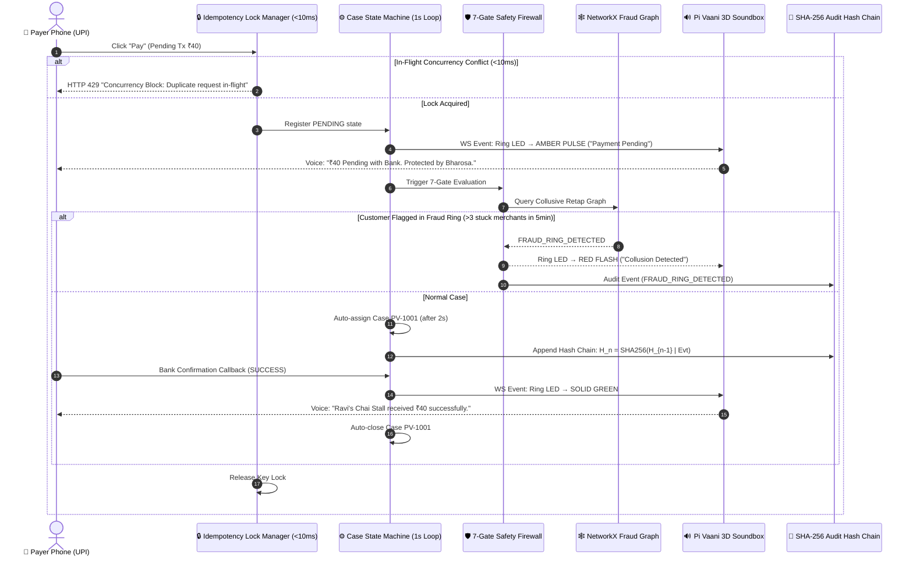

<div align="center">


<br/>
<br/>

[](https://fastapi.tiangolo.com)
[](https://nextjs.org)
[](https://react.dev)
[](https://www.python.org)
[](https://tailwindcss.com)
[](https://networkx.org)
[](https://sqlite.org)

<br/>

### **Bharosa Layer for UPI · பீரவாணி**
*Deterministic Real-time Voice Soundbox · 7-Gate Safety Firewall · In-Flight Distributed Idempotency Locks · NetworkX Graph Fraud Ring Detection*

<br/>

```
      ╔═════════════════════════════════════════════════════════════════════════════╗
      ║  "Debited but not Credited?" → Pi Vaani resolves ambiguity in < 2 seconds.  ║
      ║  Zero double-spends. Zero merchant panic. Complete cryptographic audit.     ║
      ╚═════════════════════════════════════════════════════════════════════════════╝
```

<br/>

<!-- Payment Ecosystem Logos Strip -->
<p align="center">
  <b>Interoperable Across India's Digital Payments Infrastructure:</b><br/><br/>
  
  &nbsp;
  
  &nbsp;
  
  &nbsp;
  
  &nbsp;
  
  &nbsp;
  
</p>

</div>

---

## ⚡ Executive Summary

Every day across India, over **450 Million UPI transactions** take place. When a high-traffic chai stall or kirana store experiences network latency, a transaction enters the dreaded **"DEBITED BUT NOT CREDITED" (Pending)** state:

1. **Customer Frustration**: Money was cut from their bank account; they tap "Pay" again immediately.
2. **Double-Spend Disaster**: Both taps process simultaneously, charging the customer twice.
3. **Merchant Anxiety**: The merchant hears nothing from their traditional soundbox, assumes no payment, and disputes with the customer.
4. **Fraud Ring Exploitation**: Fraudsters exploit the 3-minute bank settlement window to trigger collusive retaps and chargeback scams across multiple merchants.

**Pi Vaani (பீரவாணி)** solves this at the edge by inserting a **deterministic safety layer between the customer, merchant soundbox, and banking switches**.

---

## 🏛️ System Architecture

<div align="center">
  
</div>

### 🔄 The End-to-End Deterministic Pipeline



---

## 🛡️ The 7-Gate Safety Firewall

The Pi Vaani Trust Engine enforces **deterministic, multi-variable policy evaluation** before any transaction state transition or refund is permitted:

| # | Gate Name | Evaluation Mechanism | Failure Action |
|:---:|:---|:---|:---|
| **1** | **Authority** | Validates against Merchant's Trust Dial (`Careful`, `Balanced`, `Fast`). | Block if dial does not permit automatic resolution. |
| **2** | **Amount** | Assesses against maximum auto-clearance threshold (₹100 default). | Escalate to manual merchant PIN verification. |
| **3** | **Confidence** | Checks banking gateway telemetry confidence score ($\ge 0.85$). | Retain case in OPEN state pending webhook. |
| **4** | **Identity** | Queries the **NetworkX Fraud Graph** for collusive patterns. | **Immediate Block**: *"Fraud Ring Detected: Collusive retap pattern"*. |
| **5** | **Idempotency** | Checks unique `idempotency_key` (SHA-256 digest of VPA + Amount + Tx). | HTTP 429 Concurrency rejection. |
| **6** | **Reversibility** | Verifies transaction can be cleanly reversed or finalized without double credit. | Lock payment state. |
| **7** | **Approval** | Authenticates merchant demo PIN (`4321`) for high-value actions. | Deny approval. |

---

## 🔐 High-Concurrency & Fraud Detection Engine

### 1. In-Flight Distributed Idempotency Locks (`backend/locks.py`)
In micro-retail, rapid double-tapping on mobile screens produces concurrent requests within **10 milliseconds**. Database transaction isolation alone is too slow.

Pi Vaani implements an asynchronous in-flight lock manager:
```python
# Non-blocking lock acquisition with microsecond collision prevention
key = f"retap:{payment_id}"
acquired = await lock_manager.acquire(key)
if not acquired:
    raise HTTPException(
        status_code=429,
        detail="Concurrency Block: Duplicate request detected in-flight."
    )
```

### 2. NetworkX Graph Fraud Ring Detector (`backend/fraud_graph.py`)
Fraud rings exploit pending transactions by colluding across multiple vendors within minutes. Pi Vaani builds a dynamic bipartite graph $G = (V_{customer}, V_{merchant}, E)$:

- An edge is added every time a payment enters `PENDING` and opens a case.
- A sliding window of **5 minutes** tracks all incidents.
- If a customer VPA links to **$> 3$ distinct merchant VPAs with stuck payments**, they are classified as a **Fraud Ring**:

$$\text{FraudRing}(u) = \left|\{ v \in \mathcal{N}(u) \mid \Delta t(u, v) \le 300\text{s} \}\right| > 3$$

When flagged:
- 🚨 Identity Gate fails automatically.
- 📜 Immutable Audit Event `FRAUD_RING_DETECTED` is recorded.
- 🔴 Real-time WebSocket triggers red LED warning on merchant soundbox.

### 3. Cryptographic SHA-256 Audit Hash Chain (`backend/audit.py`)
Every event is chained cryptographically to guarantee tamper evidence:

$$H_0 = \text{Genesis Hash (SYSTEM\_INIT)}$$
$$H_i = \text{SHA-256}\Big( H_{i-1} \parallel \text{Timestamp} \parallel \text{EventType} \parallel \text{Actor} \parallel \text{CanonicalJSON}(\text{Payload}) \Big)$$

Run integrity verification at any time:
```bash
curl http://localhost:8000/api/audit/verify
# Response: {"verified": true, "chain_length": 14, "broken_at_index": null}
```

---

## 📂 Project Organization

```
pivaani/
│
├── 📂 assets/
│   ├── pivaani-banner.svg         # 3D animated isometric header
│   └── architecture-diagram.svg   # Full pipeline architecture graphic
│
├── 📂 frontend/                    # Next.js 16.4 (Turbopack + React 19)
│   ├── app/
│   │   ├── page.tsx               # High-converting landing page (/)
│   │   ├── demo/page.tsx          # Real-time interactive demo (/demo)
│   │   ├── layout.tsx             # Root layout with Geist & dark theme
│   │   └── globals.css            # Tailwind CSS v4 design tokens
│   ├── components/ui/             # Shared primitives
│   ├── lib/
│   │   ├── useWebSocket.js        # Auto-reconnecting WebSocket client
│   │   └── utils.ts               # Class mergers
│   ├── Demo.jsx                   # Complete 4-zone dashboard component
│   ├── package.json
│   └── tsconfig.json
│
├── 📂 backend/                     # FastAPI Async High-Performance Server
│   ├── main.py                    # App entrypoint, lifespan & WebSocket hub
│   ├── models.py                  # SQLAlchemy models (Merchant, Payment, Case, Audit)
│   ├── schemas.py                 # Pydantic v2 validation contracts
│   ├── cases.py                   # Case State Machine (1000ms stuck monitor)
│   ├── firewall.py                # 7-Gate Safety Firewall implementation
│   ├── locks.py                   # Async Distributed Idempotency Lock Manager
│   ├── fraud_graph.py             # NetworkX Graph Fraud Ring Detector
│   ├── audit.py                   # SHA-256 tamper-evident hash chain
│   ├── sandbox.py                 # Mock payment scenario engine
│   ├── events.py                  # WebSocket connection manager
│   ├── routers/
│   │   └── sandbox_api.py         # Sandbox & approval REST endpoints
│   └── requirements.txt
│
├── README.md                      # This file
└── .gitignore
```

---

## 🚀 Quick Start Guide

### Prerequisites
- **Node.js** $\ge$ 18.0 & **pnpm**
- **Python** $\ge$ 3.10 with `pip`

---

### 1. Start the FastAPI Backend

```bash
# Navigate to the repo root
cd pivaani

# Install dependencies (fastapi, uvicorn, sqlalchemy, networkx, etc.)
pip install -r backend/requirements.txt

# Start FastAPI with auto-reloading
python -m uvicorn main:app --app-dir ./backend --host 0.0.0.0 --port 8000 --reload
```
> 🟢 Backend starts at: `http://localhost:8000`  
> 📖 Interactive Swagger docs: `http://localhost:8000/docs`

---

### 2. Start the Next.js Frontend

```bash
# In a new terminal, enter frontend directory
cd pivaani/frontend

# Install dependencies
pnpm install

# Run dev server with Turbopack
pnpm dev
```
> 🌐 Frontend starts at: `http://localhost:3000`  
> 🎮 Interactive Live Demo: `http://localhost:3000/demo`

---

## 🎮 Interactive Live Demo Walkthrough

Navigate to [`http://localhost:3000/demo`](http://localhost:3000/demo):

| Zone | Visual Feature | Live Interactive Behavior |
|:---|:---|:---|
| **📱 Customer Phone** | CSS Phone frame with notch | Click **Pay ₹40** → Transitions from `IDLE` → `PROCESSING` → `PENDING`. |
| **🔊 3D Soundbox** | LED ring speaker with mic | LED turns **PULSING AMBER** during pending; **SOLID GREEN** on confirm; voice captions display live. |
| **🏪 Merchant Panel** | Trust dial chips & Case Card | Trust dial toggles (`Careful`, `Balanced`, `Fast`); active case `PV-1001` auto-generates in 2s; 7-gate panel evaluates in real-time. |
| **📜 Audit Trail** | Monospaced tamper-proof terminal | Streaming SHA-256 hashes for every lifecycle event; **Verify Integrity** button verifies chain live. |
| **🎛️ Control Drawer** | Press <kbd>C</kbd> on keyboard | Hidden test drawer: Trigger retaps (testing 429 locks), attack fraud ring simulation, force success. |

---

## 🧪 REST & WebSocket API Specification

### Core Endpoints

#### `POST /api/sandbox/pay`
Creates a mock payment in the specified scenario:
```bash
curl -X POST http://localhost:8000/api/sandbox/pay \
  -H "Content-Type: application/json" \
  -d '{"amount": 40, "scenario": "pending"}'
```

#### `POST /api/sandbox/retap` (Distributed Lock Protected)
Simulates a rapid retap. If called simultaneously, returns HTTP 429:
```bash
curl -X POST http://localhost:8000/api/sandbox/retap \
  -H "Content-Type: application/json" \
  -d '{"payment_id": 1}'
```

#### `GET /api/fraud/graph`
Returns the active NetworkX collusion graph as JSON nodes and edges:
```bash
curl http://localhost:8000/api/fraud/graph
```

#### `POST /api/sandbox/simulate-fraud-ring`
Simulates a collusive attack across 4 distinct merchant VPAs:
```bash
curl -X POST "http://localhost:8000/api/sandbox/simulate-fraud-ring?customer_vpa=attacker@upi"
```

#### `GET /api/audit/verify`
Validates the cryptographic hash chain from Genesis to the latest event:
```bash
curl http://localhost:8000/api/audit/verify
```

---

## 👥 Engineering & Research Team

Built with pride by **ImpactMinds**:

- **Mohammed Noufal V** — *Core Architecture, Deterministic Engine & Full-Stack Systems*
- **ImpactMinds Research Lab** — *Fintech Protocol Design & Fraud Graph Modeling*

---

<div align="center">
  <sub>Pi Vaani (பீரவாணி) · Deterministic Payment Trust for India's Next 500 Million Digital Citizens.</sub>
</div>
